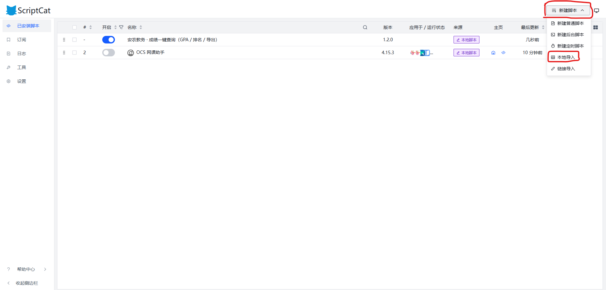
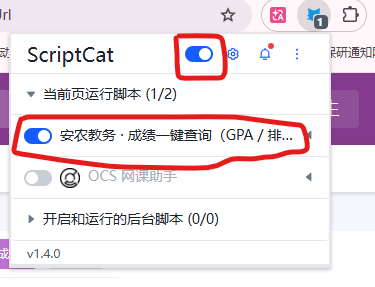

# AAU-grade-query-and-AAU-rank-checker

这是一个由安徽农业大学本科生设计的成绩与绩点实时排名查询脚本/插件，旨在为您提供便捷的成绩查询体验，支持**一键获取累计GPA、学分统计及各学期与全程专业排名**。

## ✨ 适配范围

本脚本专为以下教务系统网页端适配开发：
*   **系统名称**：数值安农 新本科教务
*   **支持地址**：
    *   `e.ahau.edu.cn/ipcheck6.jsp`
    *   `https://bkjw.ahau.edu.cn/`（需隧道连接）

## 🧩 所需依赖

在使用本脚本之前，您需要先安装支持用户脚本的浏览器扩展程序：
*   **ScriptCat（脚本猫）**：[点击此处前往官网下载与了解详情 (https://docs.scriptcat.org/)](https://docs.scriptcat.org/)

## 🚀 使用步骤

请按照以下简单步骤安装并使用：

1.  **下载并安装脚本猫**
    前往 ScriptCat 官网，根据您的浏览器下载并安装扩展插件。
2.  **安装查询脚本**
    点击安装本仓库中的脚本：[**AAU.yifly.rankchecker.js**](./AAU.yifly.rankchecker.js) （点击即可查看源码，如果在浏览器中安装了脚本猫，通常可以直接识别并提示安装）。
    
3.  **确认启用状态 (⚠️重要)**
    在查询前，请务必注意检查并确保**脚本猫插件处于打开状态**，并且**已启用本脚本**。
    
4.  **登录教务系统**
    访问并登录安徽农业大学教务系统，导航进入**“我的成绩”**界面。
5.  **一键获取**
    **刷新页面**，然后点击页面上生成的**“一键查询成绩”**按钮，即可快速查看您的各项成绩与排名数据。
    
6.  **抓取结果示例**
    

## ☕ 赞赏与支持

如果这个脚本为你节省了时间，或者觉得很好用，“请我喝一杯奶茶，吃一次学长烤猪蹄”吧！

手搓邮箱，欢迎试用：https://mail.yifly.site/

## 🤝 贡献与反馈

如果您在使用过程中遇到任何问题，或有新的功能建议，欢迎提交 Issue。
